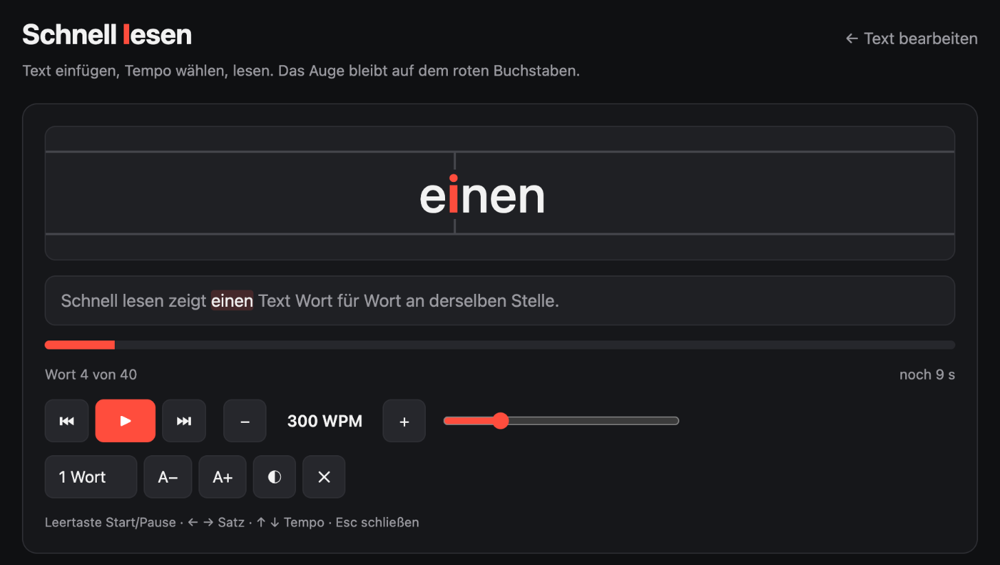

# Schnell lesen

[](LICENSE)
[](https://github.com/apa-git/schneller-lesen/releases/latest)

**LinkedIn-Beiträge und Webtexte in einem Bruchteil der Zeit lesen.** Schnell lesen zeigt einen Text Wort für Wort an derselben Stelle. Ein Buchstabe pro Wort ist rot markiert und steht immer auf derselben Achse. Das Auge muss nicht mehr springen, deshalb liest du deutlich schneller. Das Verfahren heißt RSVP (Rapid Serial Visual Presentation).



*English summary [below](#english).*

## Funktionen

- **Knopf an jedem LinkedIn-Beitrag.** Ein Klick auf „Schnell lesen“ unter dem Beitrag öffnet genau diesen Text, auch wenn LinkedIn ihn mit „… mehr“ kürzt.
- **Jede Webseite.** Text markieren und per Rechtsklick lesen, oder ohne Auswahl den Hauptartikel der Seite lesen.
- **Eigene App zum Einfügen.** Eine einzelne HTML-Datei, die offline läuft. Text einfügen und lesen.
- **Einstellbares Tempo** von 100 bis 1000 Wörtern pro Minute. Die Einstellung bleibt gespeichert.
- **Natürliche Pausen** an Komma, Satzende und Absatz, mehr Zeit für lange Wörter und Zahlen.
- **Startet erst auf Knopfdruck.** Pausieren zeigt den Satz im Zusammenhang, ein Klick auf ein Wort springt dorthin.
- **Datenschutz:** Kein Server, kein Konto, kein Tracking. Siehe [PRIVACY.md](PRIVACY.md).

## Installation

### Chrome-Erweiterung

Läuft in Chrome, Edge, Brave und Arc. Noch nicht im Chrome Web Store, deshalb wird sie einmalig von Hand geladen.

1. Lade unter [Releases](https://github.com/apa-git/schneller-lesen/releases/latest) die Datei `schnell-lesen-<version>.zip` herunter und entpacke sie. Lege den entpackten Ordner an eine Stelle, an der er bleibt, zum Beispiel unter `Dokumente`. Chrome lädt die Erweiterung bei jedem Start aus diesem Ordner.
2. Gib in Chrome `chrome://extensions` in die Adresszeile ein.
3. Schalte oben rechts **Entwicklermodus** ein.
4. Klick links oben auf **Entpackte Erweiterung laden** und wähle den entpackten Ordner. Darin muss direkt die Datei `manifest.json` liegen.
5. Klick oben rechts in Chrome auf das Puzzleteil und pinne „Schnell lesen“ an.
6. Lade offene LinkedIn-Tabs neu (⌘R bzw. Strg+R).

**Update:** Neue ZIP herunterladen und den Inhalt des alten Ordners damit ersetzen. Klick dann in `chrome://extensions` bei „Schnell lesen“ auf ↻.

### App ohne Installation

Lade unter [Releases](https://github.com/apa-git/schneller-lesen/releases/latest) die Datei `schnell-lesen-app.html` herunter und öffne sie per Doppelklick. Füge Text ein (⌘V) und klick **Lesen starten**.

## Benutzung

| Wo | Was du tust |
|---|---|
| LinkedIn | Unter dem Beitrag auf **⚡ Schnell lesen** klicken |
| Jede Webseite, Auswahl | Text markieren, Rechtsklick, **Schnell lesen** |
| Jede Webseite, ganzer Artikel | Ohne Auswahl auf das Symbol klicken oder Alt+Shift+R drücken |

Im Leser:

| Taste | Wirkung |
|---|---|
| Leertaste oder Klick ins Lesefeld | Start/Pause |
| ← / → | Satz zurück/vor |
| ↑ / ↓ | ±25 Wörter pro Minute |
| Esc | Schließen |

- Ein Klick in den Fortschrittsbalken springt an diese Stelle.
- Wählbar sind außerdem 1–3 Wörter pro Einblendung, die Schriftgröße und Hell/Dunkel.
- Das Tastenkürzel änderst du unter `chrome://extensions/shortcuts`.

**Tipp zum Tempo:** 300 WPM ist ein guter Start. Erhöhe in 25er-Schritten, solange du den Inhalt noch wiedergeben kannst.

## Datenschutz

Die Erweiterung sendet nichts und baut keine Netzwerkverbindung auf. Sie speichert nur deine Einstellungen lokal im Browser. Details zu jeder Berechtigung stehen in [PRIVACY.md](PRIVACY.md).

## Bekannte Grenzen

- **LinkedIn ändert seine Seitenstruktur regelmäßig.** Fehlen die Knöpfe plötzlich, markiere den Text und lies über das Rechtsklick-Menü. Melde es gern als [Issue](https://github.com/apa-git/schneller-lesen/issues).
- Auf `chrome://`-Seiten, im Chrome Web Store und im PDF-Viewer darf keine Erweiterung laufen. Dort zeigt das Symbol kurz ein rotes „!“.
- Safari und Firefox werden noch nicht unterstützt.
- Die Oberfläche ist deutsch.

## Entwicklung

Keine Abhängigkeiten, kein Build-Werkzeug außer Node.js für Tests und Kopierschritt.

```
core/            Lese-Kern (einzige Quelle) und Tests
app/             index.template.html → build.sh → index.html (Kern eingebettet)
extension/       Manifest V3: background.js, content.js, linkedin.js, Kopie des Kerns
tools/           Paket-Skript, Icon-Generator, Testseiten
docs/            Bilder für diese Seite
build.sh         verteilt core/ an app/ und extension/
```

| Aufgabe | Befehl |
|---|---|
| Kern an App und Erweiterung verteilen | `sh build.sh` |
| Tests | `node --test core/rsvp.test.js` |
| Release-ZIP bauen | `sh tools/package.sh` (legt `dist/schnell-lesen-<version>.zip` an) |
| Erweiterung ohne Installation testen | `python3 -m http.server 8932` im Projektordner, dann `http://127.0.0.1:8932/tools/testseite.html` oder `…/testseite-linkedin.html` öffnen |

Änderungen am Lese-Kern gehören nach `core/`. Die Dateien `app/index.html` und `extension/rsvp.*` werden von `build.sh` erzeugt. Die LinkedIn-Anker stehen am Anfang von `extension/linkedin.js`.

Alle Änderungen pro Version stehen im [CHANGELOG](CHANGELOG.md).

## Mitwirken

Fehler und Ideen bitte als [Issue](https://github.com/apa-git/schneller-lesen/issues). Pull Requests sind willkommen. Bitte vorher `node --test core/rsvp.test.js` laufen lassen und `sh build.sh` ausführen.

## Lizenz

[MIT](LICENSE) © 2026 Andreas Paehge. Du darfst den Code nutzen, ändern und weitergeben, auch kommerziell, solange der Lizenzhinweis mit meinem Namen erhalten bleibt.

## Autor

**Andreas Paehge**, [@apa-git](https://github.com/apa-git)

---

## English

**Schnell lesen** ("read fast") is a speed reader for LinkedIn and the web. It shows text one word at a time at a fixed position, with one letter highlighted in red (the optimal recognition point) so your eyes never have to move.

- **Chrome extension:** adds a "Schnell lesen" button to every LinkedIn post, reads selected text via the context menu, or the main article of any page via the toolbar icon or Alt+Shift+R.
- **Standalone app:** a single offline HTML file, paste text and read.
- **Adjustable speed:** 100–1000 words per minute, remembered across sessions, with natural pauses at punctuation.
- **Privacy:** no server, no account, no tracking. See [PRIVACY.md](PRIVACY.md).

**Install:** Download `schnell-lesen-<version>.zip` from [Releases](https://github.com/apa-git/schneller-lesen/releases/latest) and unzip it. In Chrome, open `chrome://extensions`, enable *Developer mode*, then click *Load unpacked* and select the unzipped folder.

The user interface is German. Licensed under [MIT](LICENSE) © 2026 Andreas Paehge.
